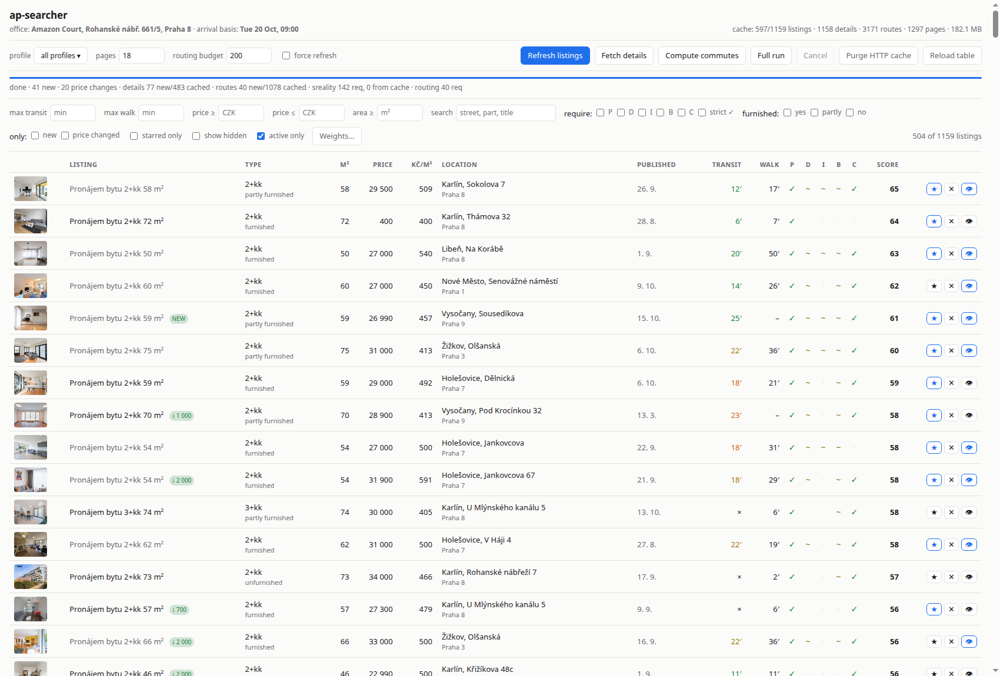

# ap-searcher

Local web app that searches apartments on [sreality.cz](https://www.sreality.cz/), adds commute
time to a fixed office address (walking and public transport), detects five amenities that
sreality does not filter on, and presents everything in one sortable table. All operations are
buttons on the page; results and fetched pages are cached in SQLite so repeated runs cost no
requests.



## Requirements

| Item | Value |
|---|---|
| Python | 3.12+ |
| Packages | `requests`, `PyYAML`, `Jinja2` (Debian/Ubuntu: `python3-requests python3-yaml python3-jinja2`) |
| Network | outbound HTTPS to `www.sreality.cz` and `api.transitous.org` |
| Accounts / API keys | none |

No virtualenv is needed — the three packages ship with the distro.

## Quick start

```bash
git clone git@github.com:jnt2007/ap-searcher.git
cd ap-searcher
cp config.example.yaml config.yaml   # then set `contact` and `office` to your own
python3 -m ap_searcher               # serves http://127.0.0.1:8765/ and opens a browser
```

Options: `--config PATH`, `--host`, `--port`, `--no-browser`, `--debug`.

`config.yaml` is gitignored: it holds your contact address, your office and your search
profiles, and the weight sliders write back to it. `config.example.yaml` is the tracked copy
and the two are the same shape.

First use: press **Full run**. Expect ~1.5 s per listing for details and ~2 s per listing for
routing on a cold cache; a 20-listing page takes about 100 s. Every later run reuses the cache.

## Configuration (`config.yaml`)

Copy `config.example.yaml` to `config.yaml` first — see *Quick start*.

| Key | Meaning |
|---|---|
| `contact` | E-mail placed in the `User-Agent`. Required by the Transitous fair-use policy. Set it to your own address before the first run. |
| `office.lat` / `office.lon` / `office.name` | Commute destination. Default: Amazon Court, Rohanské nábř. 661/5, Praha 8. |
| `commute.arrive_by`, `commute.weekday` | Arrival basis for routing, Europe/Prague. The next occurrence of that weekday is used and rolls forward automatically. |
| `commute.walk_max_km` | Straight-line cut-off above which walking is not routed (shown as `–`). |
| `profiles[]` | Search profiles: `deal` (`pronajem`/`prodej`), `kind`, `locality` slug (`praha`, or `praha-8,praha-2`), `price_from/to`, `area_from/to`, `dispositions` (`["2+kk","3+kk"]`), `max_pages`. |
| `profiles[].areas` | Optional list of `{locality, neighborhoods}` entries, for a profile that spans more than one locality (all of Praha 9 *plus* Holešovice in Praha 7). Each is swept separately, up to `max_pages` each, with its own neighbourhood filter. Mutually exclusive with the profile-level `locality`/`neighborhoods`, which are the one-area shorthand. |
| `profiles[].furnished` | Optional furnishing states to search for: any of `yes`, `"no"`, `partly`. Sent as sreality's `?vybaveni=`, so the site does the filtering and ads that leave the field blank (about a third) never arrive. Quote `"no"` — bare `no` is boolean false in YAML, though that spelling is accepted too. |
| `profiles[].neighborhoods` | Optional city parts to keep, e.g. `["Vysočany"]`. Applied to the results after the search — sreality's listing search has no city-part filter — so scope `locality` to the containing district and raise `max_pages` enough to sweep it. Matching ignores case and diacritics. |
| `profiles[].lat_min/lat_max/lon_min/lon_max` | Optional map bounding box. All four or none; sends sreality's `lat-min/lat-max/lon-min/lon-max`. Narrows the search server-side, so fewer pages and fewer routing calls. |
| `routing.base_url` | MOTIS instance. Default `https://api.transitous.org`. |
| `routing.min_interval_s`, `routing.max_requests_per_run` | Rate limit and per-run request budget. |
| `sreality.min_interval_s` | Delay between sreality page fetches. |
| `cache.*` | DB path and TTLs: `search_ttl_h`, `detail_ttl_d`, `walk_ttl_d`, `transit_ttl_d`. |
| `scoring.weights` | Weights for the score column. Editable live in the UI; **Save to config.yaml** patches these numbers in place, leaving the rest of the file and its comments untouched. |

Locality slugs come straight from sreality URLs: open a search there, copy the segment after
`/hledani/<deal>/<kind>/`.

The same applies to the bounding box: draw the area on sreality's map and copy the four
`lat-min/lat-max/lon-min/lon-max` values out of the resulting URL. Parameters are named the same on
the localised URLs (`/ru/search/to-rent/apartments/praha?...`), and the rest of such a URL maps onto
the profile directly — `max-price` → `price_to`, `disposition=2+1,2+kt` → `dispositions: ["2+1", "2+kk"]`.

### Furnishing

There are two places furnishing can be filtered, and the shipped config deliberately uses only the
second one.

`furnished` on a profile is a real sreality filter, unlike `neighborhoods`: the request carries
`?vybaveni=castecne,nevybaveny` and the site answers with only those ads, so no pages are fetched
and discarded. **No profile here sets it** — every state is searched, and the picking is done with
the **furnished** checkboxes in the page toolbar instead.

That trade is deliberate. Filtering at the site is cheaper, but it is also permanent: the ads it
excludes never enter the cache, the roughly one third of ads that leave the field blank are thrown
away with them, and changing your mind means a fresh sweep. Filtering in the page costs more pages
and more detail fetches, and in exchange every state stays one click away.

Both use the same vocabulary (`yes` / `partly` / `no`) and the same underlying enum, so they can be
cross-checked against each other. The toolbar filter reads the state from the **detail** page, so a
listing whose detail has not been fetched yet has no state to match and drops out of a ticked
filter — run *Fetch details* after a sweep for the boxes to mean anything.

### Areas

A profile searches one locality by default. `areas` lets it search several, each with its own
neighbourhood filter — the shipped `up-to-25k-p9-holesovice` is the worked example:

```yaml
areas:
- locality: praha-9              # the whole district
- locality: praha-7
  neighborhoods:
  - Holešovice                   # only this part of it
```

This is the only way to express "all of district A plus one city part of district B": a district
slug and a neighbourhood filter cannot do it alone, since `neighborhoods` narrows results rather
than adding them. Each area costs its own page sweep, and removal detection needs *every* area
swept to the end, so `max_pages` must cover the largest of them.

### Neighbourhoods

A city part (Vysočany, Karlín, …) cannot be expressed in a sreality search URL: the site's `ctvrt`
parameter belongs to its price-map route and is dropped on `/hledani/`, and there is no path slug
below the district level. `neighborhoods` therefore filters the results after the fetch, on the
`cityPart` each result already carries.

Two consequences:

- Point `locality` at the smallest slug that still contains the area (`praha-9` for Vysočany) —
  otherwise every page fetched is mostly discarded.
- Set `max_pages` high enough to sweep that district's whole result set (22 per page). A partial
  sweep silently hides matches that sit on later pages, and disables removal detection.

The shipped neighbourhood profiles are the worked examples — same filters (2+kk/3+kk, 40 m²+,
20 000–35 000 Kč), one city part each:

| Profile | `locality` | `max_pages` | District set | Kept |
|---|---|---|---|---|
| `up-to-35k-vysocany` | `praha-9` | 10 | ≈160 | ≈47 |
| `up-to-35k-zizkov` | `praha-3` | 7 | ≈92 | ≈58 |
| `up-to-35k-karlin` | `praha-8` | 7 | ≈102 | ≈34 |
| `up-to-35k-smichov` | `praha-5` | 14 | ≈239 | ≈49 |
| `up-to-35k-holesovice` | `praha-7` | 5 | ≈45 | ≈35 |

Each city part was checked to live wholly inside the district named here (Praha 1, 2, 8 and 10 were
swept as well and contain none of them), so the district sweep cannot miss a match.

## Data sources

**Listings.** sreality's public JSON API is gone (`/api/cs/v2/estates` → 404, `/api/v1/estates` →
401). The site is a Next.js app, so each search and detail page embeds its complete payload in
`<script id="__NEXT_DATA__">`; the app fetches the HTML and reads that JSON. No key, no HTML
scraping, no browser automation.

Requested filters are compared against the filter set sreality echoes back in the response
(`queryHash`). A mismatch — a renamed query parameter, an unrecognised locality — is reported as a
warning under the progress bar instead of silently returning the wrong result set.

*Note:* `sreality.cz/robots.txt` disallows non-Googlebot agents. This tool fetches a few dozen
pages per run at 1.5 s intervals with an identifying `User-Agent` and caches aggressively, but it
is running against that file's stated preference.

**Commutes.** [Transitous](https://transitous.org/) (MOTIS engine), free and key-less, covering
Prague PID plus ČD via national GTFS feeds. Both modes come from `/api/v1/plan`: public transport
as a normal itinerary, walking as `directModes=WALK`. Their policy asks for an identifying
`User-Agent`, non-commercial use, and contact before heavy routing volume — hence the request
budget, rate limit and route cache. For unlimited use, run a local MOTIS container with Czech GTFS
and point `routing.base_url` at it.

Attribution: routing data © [Transitous sources](https://transitous.org/sources/) and
[OpenStreetMap contributors](https://www.openstreetmap.org/copyright).

## Amenity detection

Three states, so a guess from ad prose is never shown as a fact:

| State | Shown | Meaning |
|---|---|---|
| `yes` | `✓` | Confirmed by a structured field on the detail page |
| `maybe` | `~` | Matched in the Czech description text (hover shows the phrase) |
| `unknown` | `·` | No evidence |

| Amenity | Structured source | Text patterns |
|---|---|---|
| Parking | `garage`, `parkingLots`, `garageCount`, `parking` | `parkov*`, `garáž*`, `carport`, `garážové/parkovací/venkovní stání` |
| Dishwasher | — none on sreality | `myčk*` |
| Induction hob | — none | `indukc*`, `indukční*` |
| Bathtub | — none | `vana/vanu/vany/vanou`, `rohová vana` |
| Cellar | `cellar`, `cellarArea` | `sklep*` (sklep / sklepa / sklepní kóje), `sklípek*` |

Matching runs on a diacritics-folded copy of the text, so `mycka` and `myčka` both hit. A match
preceded by `bez`, `není`, `nemá`, `chybí`, `nejsou`, `nelze`, `nenáleží` within 24 characters is
discarded, as is one followed by a labelled denial (`Sklep: Není`) — agents paste the spec table
into the description. A trailing negation counts only in that labelled form: in free prose
*parkování není problém* advertises parking rather than denying it, and *nejde pouze o parkovací
stání, ale o garáž* is for the same reason not treated as a negation.

Bare `stání` is never matched alone — it appears in street names such as *náměstí Povstání*.
`komora` (pantry) is not a cellar. Rules live at the top of `ap_searcher/amenities.py`.

`cellar` is the second amenity with a structured field, and its field is present on every detail
page, so a `false` there is an explicit "no" rather than silence. The three states have no slot for
that, and a falsy field falls through to the text rules exactly as `garage` does — so an ad whose
checkbox is unticked can still show `~` on the strength of its own prose. The `strict ✓` filter is
the way to demand the checkbox.

## The page

**Toolbar** — profile picker, force-refresh toggle, and the
actions: *Refresh listings* (search only), *Fetch details* (detail pages + amenities), *Compute
commutes* (routing only), *Full run*, *Cancel*, *Purge HTTP cache*, *Reload table*. One job runs at
a time; the progress bar and status line show stage, position and, when finished, how many requests
went out versus came from cache.

**Profile picker** — a dropdown of checkboxes; tick as many as you like. The selection both filters
the table and scopes the next run, so *Refresh listings* with two profiles ticked sweeps exactly
those two. A listing that belongs to several selected profiles is still listed once.

Ticking nothing is not the same as ticking everything: an empty selection means "no filter at all",
which also shows listings left behind by profiles that have since been renamed or removed from
`config.yaml`, while ticking every box restricts the table to the profiles that currently exist.
The button says *all profiles* for the first and *N profiles* for the second.

**Filters** — max transit, max walk, price from/to, min area, free-text, required amenities
(`strict ✓` demands structured confirmation), furnished, new, price-changed, starred-only,
show-hidden, active-only. All filtering and sorting happens in the browser over the fetched JSON.

*new* and *price changed* are the filter form of the two badges and use exactly the same rule, so a
ticked box shows the rows carrying that badge: *new* means `first_seen` is under 48 h old, *price
changed* means the last two recorded prices differ in either direction. Both read data the server
already sends with every row, so neither costs a request. Price history is only appended when a
sweep sees a different price, so *price changed* keeps matching until the next change — it is "has
ever moved", not "moved in the last run".

**Furnished** comes from the structured `furnished` field on the detail page: `yes` (Ano),
`partly` (Částečně), `no` (Ne), or `unknown` when the advertiser left it blank — which about a
third of them do, so a blank is deliberately not treated as "unfurnished". The state is shown under
the disposition. The three boxes — *yes*, *partly*, *no* — keep only the states you tick, in any
combination, and ticking any of them also drops the `unknown` ads; leave all three unticked to
impose no constraint. Ticking all three is therefore not the same as ticking none: it means
"furnishing is stated, whatever it says".

Note that this filters the loaded table, which is independent of a profile's `furnished` setting —
that one is applied by sreality when searching, so those ads never reach the table at all.

**Columns** — thumbnail, title (links to sreality), disposition, m², price, Kč/m², location,
published date, transit minutes, walk minutes, the five amenity ticks, score, actions. Badges:
`NEW` (first seen under 48 h ago), `↓/↑` price change, `GONE` (no longer in results). Hover a
commute cell for the leg summary, an amenity tick for its evidence, the score for its breakdown,
the published date for its age and last edit.

**Transit colour** — the transit minutes are tinted by the number of transfers the itinerary
needs: green direct, yellow one change, orange two, red three or more. Minutes alone hide the
difference between a single tram ride and three changes that happen to add up to the same time.
The exact count is in the cell's tooltip, next to the leg summary. Walk minutes are never tinted.

**Published date** comes from the detail page (`since`, with `edited` as the last change), so it
only appears once details have been fetched. Click the column header to sort by it — newest first,
then again for oldest first. Listings missing a value sort to the bottom in both directions, as
they do for commute and price. The search itself is always requested in sreality's `-date` order,
so a sweep sees the newest ads first.

**Score** — weighted 0–100 over commute, price, area and the amenities, each normalised across the
currently loaded set; amenity contribution is 1.0 for `✓`, 0.6 for `~`, 0 for `·`. Sliders under
**Weights…** re-score instantly in the browser.

**Star / hide / viewed** — written straight to SQLite (`marks`), so they survive restarts. Hidden
listings disappear from the table unless *show hidden* is ticked. `viewed` (👁) is independent of
the star/hide choice — a listing can be shortlisted and viewed at once — and greys out the title of
a row already looked at.

## HTTP API

| Method | Path | Purpose |
|---|---|---|
| GET | `/` | The page |
| GET | `/api/listings?profile=&include_hidden=1` | Listings joined with amenities, routes, marks, badges. `profile` takes one name or a comma-separated list; empty means every profile |
| GET | `/api/config` | Office, profiles, weights, commute basis |
| POST | `/api/run` | `{profile, search, details, routing, max_pages, budget, force, label}` → job; 409 if one is running. `profile` takes one name, a comma-separated list, or a JSON array; empty means every profile |
| GET | `/api/jobs/current` | Live job status and the last result summary |
| POST | `/api/jobs/cancel` | Cancel the running job |
| POST | `/api/mark` | `{id, state: star\|hide\|clear, note, viewed: true\|false}` — `state` and `viewed` are independent, either may be sent alone |
| POST | `/api/weights` | `{weights: {...}}`, also written to `config.yaml` |
| GET / DELETE | `/api/cache` | Cache stats / purge (`?kind=http\|routes\|details\|all&older_than_d=N`) |

## Routing budget

`routing.max_requests_per_run` (or `budget` in a `/api/run` body) caps the number
of **outbound requests to the routing service in one run** — not the number of listings. Cached
routes, and walk legs skipped as `too_far`, cost nothing; listings in the same building share one
request because keys are coordinates rounded to 5 decimals.

Cost per listing: one transit request, plus one walk request when within `walk_max_km`.

Hitting the cap is harmless. Routing stops, a warning appears under the progress bar
(`routing: request budget of N reached`), everything already computed stays saved, and pressing
*Compute commutes* again continues where it stopped. Two runs at 200 reach the same place as one
run at 400.

The service itself (Transitous) enforces no quota and needs no key. The limit is their fair-use
policy: open-source/non-commercial, an identifying `User-Agent`, and contact them before heavy
routing volume. The budget, the 1 s spacing and the route cache exist to honour that. For unlimited
volume, run MOTIS locally and set `routing.base_url`.

## Cache

Single SQLite file (`cache.sqlite3`, WAL). HTTP bodies are stored deflated — sreality pages are
~700 KB each, ~35 KB compressed.

| Data | TTL | Notes |
|---|---|---|
| Search pages | `search_ttl_h` (6 h) | |
| Detail pages | `detail_ttl_d` (14 d) | |
| Transit routes | `transit_ttl_d` (7 d) | Key includes the arrival timestamp, which shifts weekly |
| Walk routes | `walk_ttl_d` (90 d) | Key carries no timestamp — walking time cannot change with the timetable, so walks are not recomputed when the arrival week rolls over |
| Listings, price history, amenities, marks | kept | Price history drives the change badge |
| Publication dates, furnished state | kept | Read from cached details; backfilled with no network on the next run |

Route cache keys are coordinates rounded to 5 decimals, so listings in the same building share one
routing request.

## Tests

```bash
python3 -m pytest tests -q
```

130 offline tests: fixture-driven parsing of both `__NEXT_DATA__` shapes (`fixtures/`), amenity
rules including negation and diacritics-free ads, config and arrival-date logic, cache/TTL/diff
behaviour, routing helpers, pipeline runs against a stubbed fetcher, and the HTTP API surface.

## Troubleshooting

| Symptom | Cause / fix |
|---|---|
| Warning `filter mismatch` | sreality renamed a query parameter, or the locality slug is unknown. Check the slug in a browser; update `build_search_url` / `check_filters` in `ap_searcher/sreality.py`. |
| `ParseError: no __NEXT_DATA__` | The site changed shape, or a page returned a consent/error wall. Run with `--debug`. |
| Warning `request budget … reached` | Raise `routing.max_requests_per_run`, or run *Compute commutes* again — cached routes are not recomputed. |
| Transit cell shows `×` | MOTIS found no itinerary (rural address, or feed gap). |
| Walk cell shows `–` | Beyond `commute.walk_max_km`, or not computed yet. |
| Thumbnails blank | The image CDN only serves the whitelisted `?fl=res,100,100,1|jpg,80` transform; bare URLs answer 401. |
| DB growing | *Purge HTTP cache*, or `DELETE /api/cache?kind=all&older_than_d=30`. |

## Limitations

- Dishwasher, induction hob and bathtub can never reach `✓` — sreality has no fields for them.
- An amenity added to `amenities.KEYS` backfills itself: the next *Fetch details* re-derives every
  listing whose stored keys no longer cover the set, reading cached detail pages, no requests.
- Ads priced per m² show that figure in the price column — sreality puts it in the same
  `priceCzk` field as a monthly rent, and nothing in the search payload distinguishes them.
  The detail page's `priceNote` usually says so in prose. Visible in the screenshot above as
  a 2+kk "for 400".
- Removal detection (`GONE`) only runs when the sweep covered the whole result set, i.e. when
  `max_pages × 22 ≥ total`.
- Commutes are computed for one fixed arrival moment, not a timetable-wide average.

## Licence

MIT — see [LICENSE](LICENSE).
